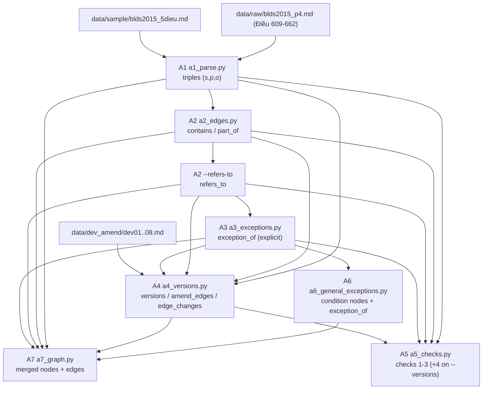

# Codebase Architecture Audit — KLTN

> **Report type:** Read-only forensic audit (System Architecture · Pipelines · Datasets · Results)
> **Repository:** `https://github.com/MrSooo/KLTN.git`
> **Audit branch:** `docs/codebase-architecture-audit` (created from `main`)
> **Head at audit time:** `b82c925 (HEAD -> main, origin/main, origin/HEAD) "Commit A6,A7"`
> **Working tree:** clean
>
> **Zero-hallucination rule applied:** every path, function, hyperparameter, split and metric below was read directly from the repository files. Anything absent or not executed is explicitly marked `[Not Found / Not Yet Executed]`.

---

## 1. Executive Summary

`e:\KLTN` is a **pure-Python, rules-based Vietnamese legal-text processing pipeline** that ingests the Vietnamese Civil Code 2015 (**Bộ luật Dân sự 2015 — "BLDS 2015"**, Part 4 — inheritance, *Điều* 609–662) and progressively transforms it into a **versioned knowledge graph** of legal units (Article → Clause → Point) and typed edges.

The pipeline is organised as seven sequential stage-modules **A1 → A7** (plus a cross-cutting verifier **A5**), each a standalone CLI script:

| Stage | Module | Responsibility |
|---|---|---|
| A1 | `src/a1_parse.py` | Parse Markdown law text → RDF-style triples `(s, p, o)` |
| A2a/A2b | `src/a2_edges.py` | Structural edges `contains`/`part_of`; cross-reference edges `refers_to` |
| A3 | `src/a3_exceptions.py` | Explicit exception edges `exception_of` (2 hard rules) |
| A4 | `src/a4_versions.py` | Versioned amendment engine (`apply` / `snapshot`) |
| A5 | `src/a5_checks.py` | Integrity verifier (codes, parentage, duplicate edges, versions) |
| A6 | `src/a6_general_exceptions.py` | General exceptions "…trừ trường hợp X" → condition nodes + `exception_of` |
| A7 | `src/a7_graph.py` | Merge everything into the final nodes/edges graph (base + "as-of date") |

**Critical finding — this is NOT a machine-learning repository.** Despite audit-template terms (training/fine-tuning, GPU/CUDA, quantization, WSL), the repo contains **no ML framework, no model, no training/inference/eval code, no GPU assumptions**. It is a deterministic, rule-based NLP + knowledge-graph system. The **only** ML-related artefact is a single future hook `a4_versions.normalize_unknown_line()` whose docstring says "sau này gắn LLM" (to be plugged with an LLM later) and which currently returns `None` (see §8).

---

## 2. Git & Repository Context

```text
origin  https://github.com/MrSooo/KLTN.git (fetch/push)
Local branch:  main  (+ new audit branch docs/codebase-architecture-audit)
Remote branches:
  origin/HEAD -> origin/main
  origin/main, origin/refactor, origin/sua-theo-review, origin/v2-lao-dong, origin/v3_refactor
Commit history (newest first):
  b82c925  Commit A6,A7
  cefdd58  Commit A4,A5
  0e57249  Commit A2,A3
  f0568fe  Init project
```

**Branch isolation performed:** `git checkout -b docs/codebase-architecture-audit` (done from a clean, up-to-date `main`; no stash needed). Verified active branch = `docs/codebase-architecture-audit`.

> Config note: `git` is installed at `C:\Program Files\Git\cmd\git.exe` but is **not on this shell's `PATH`**. Git commands must be invoked via the absolute path.

---

## 3. System Architecture & Tech Stack

### 3.1 Language, environment, dependency assumptions

| Aspect | Verdict (code-verified) |
|---|---|
| Language | Python 3 (stdlib only) |
| Minimum version | **Python ≥ 3.10** — code uses PEP 604 unions (`str | None`), e.g. `a1_parse.Unit.heading: str | None` |
| Third-party libraries | **None** — imports are only `argparse, collections, itertools, json, re, sys, unicodedata, dataclasses, pathlib, typing, hashlib, datetime` (tests add `tempfile, subprocess, contextlib, io, functools, ast`) |
| Package/config files | **None** — no `requirements.txt`, `pyproject.toml`, `setup.py`, `Makefile`, `.gitignore`, `.yaml/.yml/.ini/.cfg/.toml`, `Dockerfile`, or notebooks `[Not Found]` |
| Configuration management | **Hardcoded module-level constants** only (regexes + `EXPECTED`/`EXPECTED_DIEU` tables). No YAML/JSON/ENV/`.env` config |
| CLI args | `argparse` subcommands/flags per stage (see §5) |
| Hardware/GPU/CUDA/quantization | **Not applicable / not found** — no GPU, CUDA, quantization, or WSL/Linux paths anywhere `[Not Found]` |
| Execution mode | Scripts documented to run with **`python -I`** (isolated mode) |
| Text conventions | UTF-8; `sys.stdout.reconfigure(encoding="utf-8")`; `\`-escapes and `\xa0` normalised |

### 3.2 Complete directory structure

```text
e:\KLTN\
├─ .git\                         (VCS metadata — excluded from dump)
├─ data\
│  ├─ raw\          blds2015_p4.md                    (40.8 KB — only raw source file)
│  ├─ sample\       blds2015_5dieu.md                 (5.4 KB — 5-article dev sample)
│  ├─ dev_amend\    dev01..dev08_<name>.md            (8 hand-authored amendment docs, test fixtures)
│  └─ processed\    a1_..a7_*.jsonl/*.json/*.md       (ALL generated artifacts)
├─ docs\
│  ├─ a1_notes_*.txt, a2_unresolved_*.txt, a3_unhandled_*.txt, a6_unhandled_*.txt
│  ├─ a4_quyet_dinh.txt, a6_a7_quyet_dinh.txt, pham_vi_mo_rong.txt   (decision logs)
│  ├─ a4_report_*.txt, a5_report_*.txt, a7_report_*.txt                (recorded results)
│  └─ CODEBASE_ARCHITECTURE_AUDIT.md                  (this file)
└─ src\
   ├─ a1_parse.py … a7_graph.py                       (7 stage modules)
   ├─ test_a1.py … test_a7.py                         (7 matching test suites)
   └─ __pycache__\                                    (ignored)
```

### 3.3 Module responsibilities & key symbols

**`src/a1_parse.py` — A1 "Parse"** (15.7 KB)
- NamedTuples: `Token, Skipped, Suspicious, Tokenized, Unit, ParseError, Parsed`.
- Regexes `RE_DIEU` (`### Điều N\.`), `RE_KHOAN` (`**K\.**`), `RE_DIEM` (`- **a)**`).
- `tokenize()` classifies each line into `dieu/khoan/diem/para` with full skip/suspect accounting.
- `parse()` — state machine building `Điều > Khoản > Điểm` units; id prefix `BLDS2015`, Điểm letter `đ` encoded as `dd` in ids.
- `load_parsed()`, `to_triples`, `write_triples`, `step1_check_data`, `step2_classify`, `step3_parse`, `step4_write_triples`.
- `EXPECTED_DIEU = {"blds2015_5dieu.md": [621,626,644,650,651], "blds2015_p4.md": range(609,663)}`.

**`src/a2_edges.py` — A2a/A2b** (23.1 KB)
- A2a: `parent_of`, `build_edges`, `check_edges` → `contains` / `part_of` (both directions of each parent-child pair).
- A2b: `CHAIN_RE`, `find_refs`, `shape_of`, `group_targets`, `build_refs`, `check_refs` → `refers_to` + `unresolved`.
- A3-step-1 helper: `TRIGGER_RE`, `find_triggers`, `trigger_table` (scan "trừ / ngoại trừ / không áp dụng").

**`src/a3_exceptions.py` — A3 "explicit exceptions"** (10.4 KB)
- `find_exceptions`, `check_exceptions`; two rules only: `not_apply_pattern` and `except_list_pattern` (text ends with `"sau đây:"`). Unmatched triggers → `a3_unhandled_<stem>.txt`.

**`src/a4_versions.py` — A4 "versioned amendments"** (58.2 KB, largest module)
- `A4Error` with 25 error codes (`E_ARGS, E_BASE, E_NO_DATE, E_DATE_INVALID, E_DATE_CONFLICT, E_DATE_FLAG, E_SAME_DATE, E_UNKNOWN_LINE, E_UNSUPPORTED, E_REFLIST, E_SCOPE, E_PHRASE, E_BODY, E_ORDER, E_ROOT, E_OVERLAP, E_TARGET, E_EXISTS, E_PARENT, E_AFTER, E_HEADING, E_PHRASE_MISSING, E_A2, E_A3, E_CODE`).
- Directive grammar R1–R6 (`replace_unit`, `insert_unit`, `repeal_unit`, `rename_heading`, `phrase`, `replace_doc`) — regexes `RE_R1..R6`, `PHRASE_FORMS`, `RE_SCOPE`.
- `Store`/`Version`/`EdgeState`, `apply_series`, `impact_set`, `uncovered_mentions`, `active_rows`, `render_markdown`, `cmd_apply`, `cmd_snapshot`.
- Outputs: `a4_<name>_{versions,amend_edges,edge_changes}.jsonl` + `{changed,impact}.json` + `docs/a4_report_<name>.txt`.
- `normalize_unknown_line()` — future LLM hook (returns `None` = unknown lines are hard errors).

**`src/a5_checks.py` — A5 "verifier"** (20 KB)
- Steps 1–4 (4a–4e): code uniqueness, single-parent, duplicate `(s,p,o)` edges, version-layer integrity (contiguity, `previous_version`, non-overlapping `[effective_from, effective_to)`, A1-code preservation, content equality of version 1).
- `EXPECTED = {"blds2015_5dieu": Expect(35,5), "blds2015_p4": Expect(215,54)}`. Exit code 1 on any violation.

**`src/a6_general_exceptions.py` — A6** (11.5 KB)
- `GENERAL_RE` matches `(ngoại )trừ trường hợp`; `find_general`, `check_general`, `condition_id` (`BLDS2015.C_<8-hex-sha1>`), `norm_text` (shared with A7 for dedup).
- Outputs: `a6_conditions_<stem>.jsonl` (condition nodes `type:"dieu_kien"`), `a6_exceptions_<stem>.jsonl`, `a6_unhandled_<stem>.txt`.

**`src/a7_graph.py` — A7 "merged graph"** (22 KB)
- `EdgeSet` (dedupe by `(s,p,o)`, track `sources`/`evidences`), `mark_duplicates`, `assemble`, `graph_base`, `graph_at`, `check_graph` (7a–7f).
- Labels: node status `ok|duplicate` (edge `same_text_as`), edge status `ok|dangling`.
- `EXPECTED = {"blds2015_5dieu": Expect(35,64,0), "blds2015_p4": Expect(220,364,4)}`.

### 3.4 Dependency (import) matrix — verified from `import` statements

| Module | Imports |
|---|---|
| `a1_parse` | stdlib only |
| `a2_edges` | stdlib only |
| `a3_exceptions` | `a2_edges` |
| `a4_versions` | `a1_parse`, `a2_edges`, `a3_exceptions` |
| `a5_checks` | `a2_edges`, `a3_exceptions` |
| `a6_general_exceptions` | `a2_edges`, `a3_exceptions` |
| `a7_graph` | `a2_edges`, `a3_exceptions`, `a4_versions`, `a5_checks`, `a6_general_exceptions` |

`a7_graph` is the only module that imports everything — it is the integration point.

### 3.5 Architecture / dependency flow diagram



---

## 4. End-to-End Data & Execution Pipeline

### 4.1 Stage order

```text
raw .md ─A1→ triples ─A2a→ contains/part_of ─A2b→ refers_to ─A3→ exception_of
        ─A5(1-3)→ verify ─A4(apply/snapshot)→ versions/edge_changes ─A5(4)→ verify
        ─A6→ condition_nodes/exception_of ─A7(base or --versions --date)→ nodes+edges
```

### 4.2 Exact CLI commands (from module docstrings — all `python -I`)

```bash
# A1 — parse Markdown -> triples (4 steps; default runs all)
python -I src/a1_parse.py data/raw/blds2015_p4.md
python -I src/a1_parse.py -s 4 data/raw/blds2015_p4.md          # step 4 only (write triples)

# A2a — structural edges (path is mandatory, no default)
python -I src/a2_edges.py data/raw/blds2015_p4.md

# A2b — referential edges (two-step, same module)
python -I src/a2_edges.py data/raw/blds2015_p4.md --refs        # list refs + shape table (no file)
python -I src/a2_edges.py data/raw/blds2015_p4.md --refers-to   # write a2_refs + a2_unresolved

# A3 — explicit exceptions (and A3 step-1 trigger scan)
python -I src/a2_edges.py data/raw/blds2015_p4.md --triggers    # scan only, no file
python -I src/a3_exceptions.py data/raw/blds2015_p4.md

# A5 — verify text layer (steps 1-3)
python -I src/a5_checks.py data/raw/blds2015_p4.md

# A4 — versioned amendments
python -I src/a4_versions.py apply --base data/raw/blds2015_p4.md \
    --amend data/dev_amend/dev05_bai_bo_ds.md --name p4_dev05_bai_bo_ds
python -I src/a4_versions.py apply --base data/raw/blds2015_p4.md \
    --amend A.md --amend B.md [--effective-from YYYY-MM-DD ...] [--doc-id ID ...] [--name NAME]
python -I src/a4_versions.py snapshot --name p4_dev05_bai_bo_ds --date 2027-01-01 [--out out.md]

# A5 — verify version layer (steps 4a-4e) against a specific A4 output
python -I src/a5_checks.py data/raw/blds2015_p4.md --versions data/processed/a4_p4_dev05_bai_bo_ds_versions.jsonl

# A6 — general exceptions (condition nodes)
python -I src/a6_general_exceptions.py data/raw/blds2015_p4.md

# A7 — merged graph, base state and as-of-date state
python -I src/a7_graph.py data/raw/blds2015_p4.md
python -I src/a7_graph.py data/raw/blds2015_p4.md \
    --versions data/processed/a4_p4_dev05_bai_bo_ds_versions.jsonl --date 2027-01-01

# Tests — each suite is a self-contained runner (also pytest-compatible)
python -I src/test_a1.py
# … up to test_a7.py
```

> All paths above are relative to `e:\KLTN`. The 5-article sample is run identically by substituting `data\sample\blds2015_5dieu.md` for the source path (stem `blds2015_5dieu`).

### 4.3 Data schemas & formats at each pipeline boundary

**Input (raw law text) — `*.md`**
Markdown conventions: `### Điều N\.` (article), `**K\.**` (clause), `- **a)**` (point), literal `\` before punctuation, 2-trailing-space hard breaks.

**A1 triples JSONL** — `a1_triples_<stem>.jsonl`, one JSON object per line:
```json
{"s": "BLDS2015.D609", "p": "type", "o": "dieu"}
{"s": "BLDS2015.D609", "p": "number", "o": "609"}
{"s": "BLDS2015.D609", "p": "heading", "o": "Quyền thừa kế"}
{"s": "BLDS2015.D609", "p": "text", "o": "..."}
{"s": "BLDS2015.D609", "p": "version", "o": 1}
{"s": "BLDS2015.D609", "p": "source_line", "o": 3}
```
Predicates `p ∈ {type, number, heading, text, version, source_line}`.

**A2 structures/edges JSONL** — `a2_edges_<stem>.jsonl` / `a2_refs_<stem>.jsonl`:
```json
{"s": "BLDS2015.D611", "p": "contains", "o": "BLDS2015.D611.K1", "evidence": ""}
{"s": "BLDS2015.D611.K1", "p": "refers_to", "o": "BLDS2015.D71.K2", "evidence": "khoản 2 Điều 71 của Bộ luật này"}
```

**A3/A6 exceptions JSONL** — `a3_exceptions_<stem>.jsonl` / `a6_exceptions_<stem>.jsonl`:
```json
{"s": "BLDS2015.C_426b8c79", "p": "exception_of", "o": "BLDS2015.D615.K1",
 "evidence": "trừ trường hợp có thỏa thuận khác.", "method": "general_except_pattern"}
```

**A4 versions JSONL** — `a4_<name>_versions.jsonl`:
```json
{"id": "BLDS2015.D621.K2", "version": 1, "type": "khoan", "number": "2",
 "heading": null, "text": "...", "effective_from": null, "effective_to": null,
 "previous_version": null, "source_doc": null, "directive_seq": null}
```
Supporting files: `a4_<name>_amend_edges.jsonl` (`s=doc_id`, `p ∈ {amends,replaces,repeals}`, `o=unit`), `a4_<name>_edge_changes.jsonl` (`{op:"add"|"close", s, p, o, at}`), `a4_<name>_changed.json`, `a4_<name>_impact.json`.

**A6 condition nodes JSONL** — `a6_conditions_<stem>.jsonl`:
```json
{"s": "BLDS2015.C_426b8c79", "p": "type", "o": "dieu_kien"}
{"s": "BLDS2015.C_426b8c79", "p": "text", "o": "có thỏa thuận khác"}
```

**A7 nodes JSONL** — `a7_<stem>[_<name>_<date>]_nodes.jsonl`:
```json
{"id": "BLDS2015.D609", "type": "dieu", "number": "609",
 "heading": "Quyền thừa kế", "text": "...", "source_line": 3, "status": "ok"}
```

**A7 edges JSONL** — `a7_<stem>[_<name>_<date>]_edges.jsonl`:
```json
{"s": "BLDS2015.D611", "p": "contains", "o": "BLDS2015.D611.K1",
 "evidence": "", "method": null, "status": "ok", "sources": ["a2_edges"]}
```
(When a same `(s,p,o)` triple appears in 2+ sources it is merged into one edge and `sources`/`evidences` list all origins.)

**Report files** — `docs/a*_report_*.txt` (plain-text, includes a `KẾT LUẬN: ĐẠT / KHÔNG ĐẠT` verdict line).

---

## 5. Datasets & Storage Artifacts

### 5.1 Source documents (inputs)

| Path | Size | Role | Content (verified) |
|---|---|---|---|
| `data/raw/blds2015_p4.md` | 40.8 KB | **Full corpus** (production input) | BLDS 2015, Part 4 — inheritance, `Điều` 609–662 (54 articles) |
| `data/sample/blds2015_5dieu.md` | 5.4 KB | Dev/validation sample | 5 articles: `Điều` 621, 626, 644, 650, 651 |
| `data/dev_amend/dev01_bai_bo_khoan.md` | 0.2 KB | A4 test fixture | repeal a clause |
| `data/dev_amend/dev02_sua_khoan.md` | 1.3 KB | A4 test fixture | amend clause (effective **2027-07-01**) |
| `data/dev_amend/dev03_thay_dieu.md` | 0.7 KB | A4 test fixture | replace article (inserts clause `2a` — suffix code) |
| `data/dev_amend/dev04_bo_sung.md` | 1.0 KB | A4 test fixture | insert new units |
| `data/dev_amend/dev05_bai_bo_ds.md` | 0.3 KB | A4 test fixture | repeal list (closes 15 units) |
| `data/dev_amend/dev06_cum_tu.md` | 1.0 KB | A4 test fixture | phrase change |
| `data/dev_amend/dev07_doi_ten.md` | 0.6 KB | A4 test fixture | rename heading |
| `data/dev_amend/dev08_thay_van_ban.md` | 0.2 KB | A4 test fixture | replace whole law (`replace_doc`) |

> Amendment effective dates (from `docs/a4_quyet_dinh.txt` G6): all `2027-01-01` except `dev02` = `2027-07-01`.

### 5.2 Generated artifacts — `data/processed/`

| Family | Files | Notes |
|---|---|---|
| A1 | `a1_triples_{5dieu,p4}.jsonl` | 14 KB / 93.5 KB; triples count 176 / 1099 |
| A2a | `a2_edges_{5dieu,p4}.jsonl` | 4.9 / 26.1 KB; `contains`+`part_of` |
| A2b | `a2_refs_{5dieu,p4}.jsonl` | 0.3 / 3 KB; `refers_to` |
| A3 | `a3_exceptions_{5dieu,p4}.jsonl` | 0.2 / 0.8 KB |
| A4 (5dieu base) | `a4_dev01..dev08_*`, `a4_dev01+dev02_*`, `a4_dev01_full_*` | versions/amend_edges/edge_changes/changed/impact/snapshot |
| A4 (p4 base) | `a4_p4_dev01..dev08_*`, `a4_p4_dev01+dev02_*` | same, on full corpus |
| A6 | `a6_conditions_{5dieu,p4}.jsonl`, `a6_exceptions_{5dieu,p4}.jsonl` | `5dieu` files are 0 KB (no general exceptions in sample) |
| A7 | `a7_{5dieu,p4}_{nodes,edges}.jsonl` | base graph |
| A7 date-mode | `a7_blds2015_p4_p4_dev05_bai_bo_ds_2027-01-01_{nodes,edges}.jsonl` | only date-mode run persisted to disk |

### 5.3 Derived notes/reports — `docs/`

| Family | Purpose |
|---|---|
| `a1_notes_*.txt` | paragraphs immediately after a Điểm (suspicious layout) — **0 KB (empty)** for both stems |
| `a2_unresolved_*.txt` | references whose target Article isn't loaded (p4: 2 lines) |
| `a3_unhandled_*.txt` | triggers A3 can't handle (p4: 9 lines, all later handled by A6) |
| `a6_unhandled_*.txt` | A6 unhandled triggers — **0 KB (empty)** |
| `a4_quyet_dinh.txt` (19.7 KB) | A4 design decisions/deviations from spec |
| `a6_a7_quyet_dinh.txt` (10 KB) | A6/A7 design decisions |
| `pham_vi_mo_rong.txt` (4.5 KB) | scope & future-extension decisions |
| `a4_report_*.txt`, `a5_report_*.txt`, `a7_report_*.txt` | recorded run outputs (see §6) |

**Key cross-check values (hardcoded in code, re-derived by tests):**

| Constant | 5dieu | p4 |
|---|---|---|
| `a1_parse.EXPECTED_DIEU` | `[621,626,644,650,651]` | `range(609,663)` |
| `a5_checks.EXPECTED` (units, dieu) | (35, 5) | (215, 54) |
| `a7_graph.EXPECTED` (nodes, edges, dup) | (35, 64, 0) | (220, 364, 4) |

---

## 6. Existing Experimental Results & Benchmarks

> These are **recorded run outputs** (`docs/*_report_*.txt`), i.e. the "evaluation" artefacts of this pipeline. All four were `KẾT LUẬN: ĐẠT` (PASS). There are **no ML metrics** (accuracy/F1/BLEU/ROUGE/pass@k/latency/VRAM) because there is no ML — the equivalent "metrics" here are structural-integrity counts.

### 6.1 A5 verifier results (text layer)

| Check | `blds2015_5dieu` | `blds2015_p4` |
|---|---|---|
| 1a units (`s` with `type`) | 35 / 35 ✅ | 215 / 215 ✅ |
| 1b articles (`dieu`) | 5 / 5 ✅ | 54 / 54 ✅ |
| 1d `(s, p)` pairs checked | 176 | 1099 |
| 2a articles with no parent | 5 | 54 |
| 2b clauses+points with exactly one parent | 30 | 161 |
| 3 `(s,p,o)` triples across a2_edges+refs+exceptions | 64, **0 duplicate** | 351, **0 duplicate** |

### 6.2 A7 graph results (base state)

| Metric | `blds2015_5dieu` | `blds2015_p4` |
|---|---|---|
| Nodes total | **35** | **220** |
| Node types | dieu 5, khoan 14, diem 16 | dieu 54, khoan 115, diem 46, **dieu_kien 5** |
| Node status | ok 35 | ok 216, duplicate 4 |
| Edges total | **64** | **364** |
| Edge predicates | contains 30, part_of 30, refers_to 3, exception_of 1 | contains 161, part_of 161, refers_to 25, **exception_of 13**, same_text_as 4 |
| Merged triples | 0 | 0 |
| Duplicate (same_text_as) pairs | — | D617.K2.c→D617.K1.d; D618.K2.b→D618.K1.b; D618.K2.c→D618.K1.c; D637.K1→D632.K1 |

`exception_of = 13` on p4 decomposes as **4 explicit (A3) + 9 general (A6)**.

### 6.3 A6 general-exceptions breakdown (p4)

- 10 `trừ`/`ngoại trừ` triggers → **1 belongs to A3** (`D632`, `sau đây:` list) + **9 handled** + **0 unhandled**.
- **5 condition nodes** (`dieu_kien`), **9 `exception_of` edges**.
- Node `C_426b8c79` = "có thỏa thuận khác" is shared by 5 units (D615.K1, D615.K3, D659.K1, D662.K1, D662.K2).

### 6.4 A4 amendment results (selected, verified)

| Run | Base | Directives | changed / new / closed | flags |
|---|---|---|---|---|
| `dev01_bai_bo_khoan` | 5dieu | 1 `repeal_unit` → D621.K2 | 0 / 0 / **1** | broken 0, impact 0 |
| `p4_dev05_bai_bo_ds` | p4 | 4 `repeal_unit` (D621.K2; D650.K1.a; D626; D651) | 0 / 0 / **15** | **broken 1**: D653 → refers_to D651; impact `{D653: refers_to D651}` |

### 6.5 A7 graph "as-of date" (only persisted date-mode run)

`python -I src/a7_graph.py data/raw/blds2015_p4.md --versions data/processed/a4_p4_dev05_bai_bo_ds_versions.jsonl --date 2027-01-01`

| Metric | Value |
|---|---|
| version rows loaded | 215 |
| units active at date | 200 |
| edge_changes applied | none |
| edges dropped | structural 26 + source_closed 1 |
| nodes | **205** (dieu 52, khoan 106, diem 42, dieu_kien 5; ok 201, duplicate 4) |
| edges | **337** (ok 336, **dangling 1**: `BLDS2015.D653 refers_to BLDS2015.D651`) |

---

## 7. Known Limitations, Future Work & Discrepancies

**No TODO/FIXME/`NotImplemented` markers exist in source or docs** (searched). The following are explicit design limitations documented in the repo:

1. **The future-LLM hook is a no-op stub.** `a4_versions.normalize_unknown_line()` (`src/a4_versions.py:53-58`) — docstring says "sau này gắn LLM" (to be attached to an LLM later). Currently returns `None`, so any line A4 cannot normalise becomes a hard error `E_UNKNOWN_LINE`. **This is the only ML/AI-related code in the repo.**
2. **No ML framework, model weights, training, inference, or evaluation** anywhere `[Not Found]`. No `torch/tensorflow/jax/sklearn/transformers`, no `.pt/.pth/.bin/.safetensors` weight files, no GPU/CUDA/quantization/WSL references.
3. **Limit of A6/A7 (from `docs/pham_vi_mo_rong.txt`, `a6_a7_quyet_dinh.txt` §E):** condition-node merging is purely by identical text (`norm_text`, not semantics); only the "trừ trường hợp" wording is recognised — other exception wordings remain in `unhandled`; condition nodes have only `text` (no behaviour/subject/sub-condition decomposition — "thuộc tầng khái niệm sau này").
4. **A4 unsupported syntax (H1):** `"được bổ sung như sau"`, clause re-numbering, `"trở thành"`, multiple-paragraph edits within a single Điểm, nested quotes in R5 phrase directives, bare number lists (`"Điều 5, 6"`), a Điểm directly under a Điều. These currently raise `E_UNSUPPORTED`/`E_UNKNOWN_LINE` or are skipped.
5. **Sanction-conflict detection out of scope (A1–A2 of scope doc):** spec mentions conflict/sanction checking, but the current data (inheritance law) has no sanction nodes, so it is deferred.
6. **Duplicate naming artifact:** `a4_dev01_full_*` (base `blds2015_p4`, verified first unit `D609`) is effectively the same experiment as `a4_p4_dev01_bai_bo_khoan_*` but under a different `--name`; the 83.1 KB `dev01_full` versions file confirms p4 base.
7. **`python` not installed in this environment** — Microsoft Store alias only. The test suites therefore **could not be executed during this audit** `[Not Yet Executed]`.

---

## 8. Reproduction Runbook (verified commands)

```bash
# 0) git availability on this machine (git not on PATH)
& 'C:\Program Files\Git\cmd\git.exe' -C e:\KLTN branch --show-current

# 1) A1 → A2a → A2b → A3  (full corpus; repeat for the 5-article sample with the sample path)
python -I src/a1_parse.py data/raw/blds2015_p4.md
python -I src/a2_edges.py data/raw/blds2015_p4.md
python -I src/a2_edges.py data/raw/blds2015_p4.md --refers-to
python -I src/a3_exceptions.py data/raw/blds2015_p4.md

# 2) verify text layer
python -I src/a5_checks.py data/raw/blds2015_p4.md

# 3) A4 amendment + verify version layer (example: dev05)
python -I src/a4_versions.py apply --base data/raw/blds2015_p4.md --amend data/dev_amend/dev05_bai_bo_ds.md --name p4_dev05_bai_bo_ds
python -I src/a5_checks.py data/raw/blds2015_p4.md --versions data/processed/a4_p4_dev05_bai_bo_ds_versions.jsonl

# 4) A6 → A7 (base), A7 as-of-date
python -I src/a6_general_exceptions.py data/raw/blds2015_p4.md
python -I src/a7_graph.py data/raw/blds2015_p4.md
python -I src/a7_graph.py data/raw/blds2015_p4.md --versions data/processed/a4_p4_dev05_bai_bo_ds_versions.jsonl --date 2027-01-01

# 5) run all test suites
python -I src/test_a1.py; python -I src/test_a2.py; python -I src/test_a3.py
python -I src/test_a4.py; python -I src/test_a5.py; python -I src/test_a6.py; python -I src/test_a7.py
```

---

## 9. Conclusion

- **What it is:** a deterministic, stdlib-only Python **legal-knowledge-graph builder** for BLDS 2015 Part 4, with a clean staged architecture (A1 parse → A2/A3 edges → A4 versioning → A5 verification → A6 general exceptions → A7 merged graph) and a strong self-checking culture (every stage writes an ASCII report with a PASS/FAIL verdict; `EXPECTED` counts are independently re-derived by tests).
- **What it is not:** a machine-learning / LLM pipeline. Training, models, inference, evaluation metrics, and hardware acceleration are all **absent** — the generic audit template's ML pillars do not apply; the only LLM reference is a deliberately-empty future hook.
- **Deliverable:** this file was created at `docs/CODEBASE_ARCHITECTURE_AUDIT.md` on branch `docs/codebase-architecture-audit`. No source files, configs, or result files were modified.